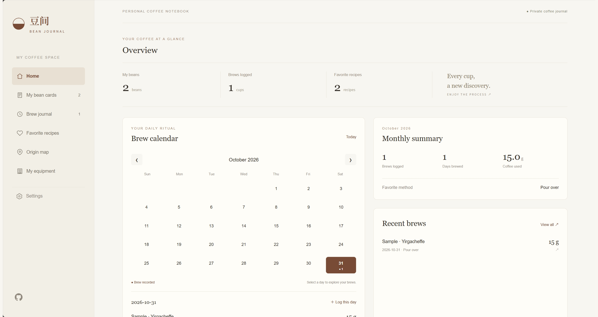
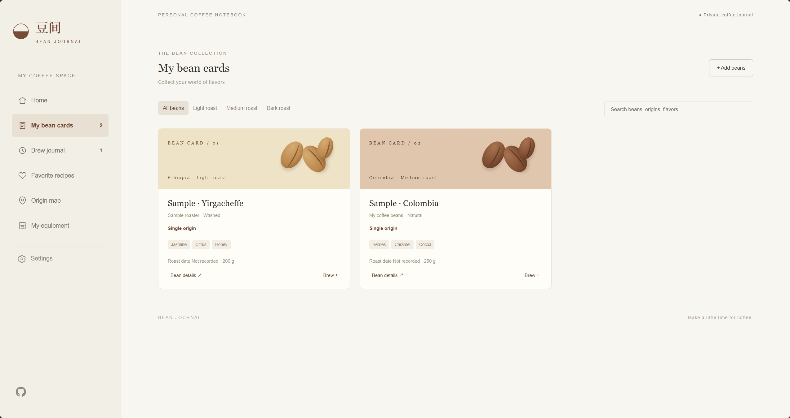
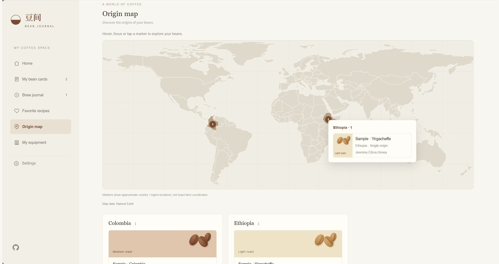
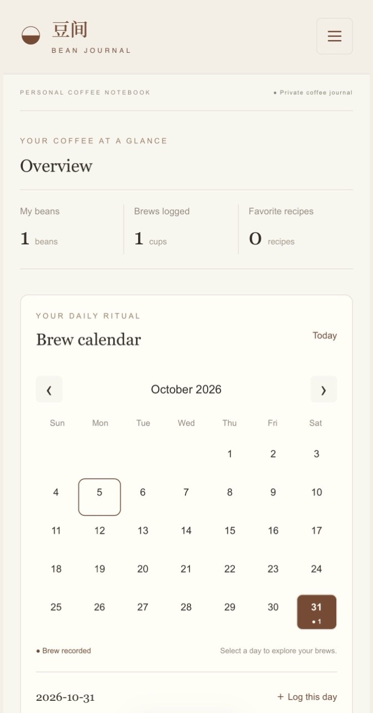
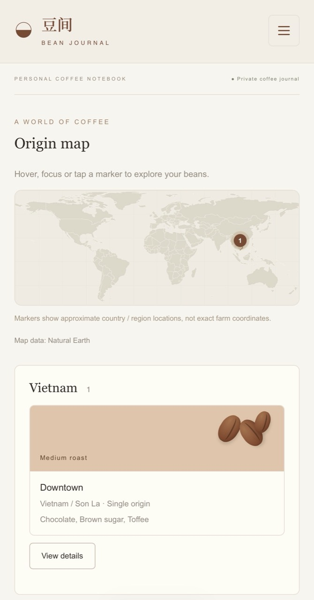

<p align="center">
  
</p>
<h1 align="center">Bean Journal · 豆间</h1>
<p align="center">
  <a href="README.md">[ 简体中文 ]</a> | <a href="README.en.md">[ English ]</a>
</p>

<p align="center">A little ritual, every day. Keep your beans, brews and favorite recipes in one place.</p>
<p align="center"><strong>v1.2 · English / 简体中文 · Light & dark themes · Browser-local storage</strong></p>

Bean Journal is a personal coffee notebook built with plain HTML, CSS and JavaScript. Collect bean cards, record each cup and keep reusable recipes—without a backend or build step.

## What's new in v1.2

- Click dashboard totals to navigate and click bean cards to open details.
- Search countries in Chinese or English and choose directly from matching results.
- Country names update immediately when switching languages; region and farm text stays unchanged.
- Add medium-dark roast selection, filtering and card colors.
- Add a brew timer beside the extraction-time input; stopping fills in elapsed seconds.
- Docker tags: 1.2, latest; platform: linux/amd64.

Data remains in each browser. v1.2 does not add accounts or cross-device sync. Export a backup in Settings before upgrading and keep the same access address and port. See [CHANGELOG.md](CHANGELOG.md) for the full release notes.

Release notes: [v1.2 — 中文 / English](docs/releases/v1.2.md). Earlier changes: [CHANGELOG.md](CHANGELOG.md).

## Screenshots

Real screenshots provided by the project owner. Desktop and phone screenshots show the English interface. All three desktop images use matching 2548 × 1351 canvases, with their full content preserved. Click any image to view it in full.

### Dashboard & brew calendar

Track your brewing days, monthly coffee usage and recent cups.

[](docs/images/dashboard-en.png)

### Bean collection

Keep origins, roast levels, processing methods and flavor notes together. Uploaded photos appear in bean details.

[](docs/images/bean-cards-en.png)

### Origin map

Explore bean origins on the map and hover over a marker to see the associated bean cards.

[](docs/images/origin-map-en.png)

### On a phone

Real phone screenshots provided by the project owner. Both images are 670 × 1280 pixels and displayed at the same size. Click either image to view it in full.

<table>
  <tr>
    <th>Dashboard & brew calendar</th>
    <th>Origin map & bean cards</th>
  </tr>
  <tr>
    <td align="center"><a href="docs/images/mobile-dashboard-en.jpg"></a></td>
    <td align="center"><a href="docs/images/mobile-origin-map-en.jpg"></a></td>
  </tr>
</table>

## Features

- **Dashboard:** overview, brew calendar, daily records, monthly summaries and recent brews.
- **Bean cards:** origin, roast level, processing method, single origin or blend, flavor notes and detail photos.
- **Brew journal:** actual grind setting, dose, yield or water weight, extraction time, temperature, rating and tasting notes for each cup.
- **Favorite recipes:** reusable target parameters, equipment and instructions. Select a recipe while brewing, view its steps and adjust the actual values independently.
- **Equipment:** add, rename or deactivate coffee machines and grinders. Historical brews retain their equipment-name snapshots.
- **Origin map:** group bean cards by recognized countries and regions, with hover details.
- **Preferences & backup:** English and Simplified Chinese, light and dark themes, JSON import and export including photos.
- **History preservation:** deleting a bean card keeps its associated brew records. Legacy favorites migrate to recipes.

## Quick start

Install **Node.js 22 or later**, then run from the project directory:

```sh
npm start
```

Open `http://127.0.0.1:8080`.

The local server uses only built-in Node.js modules, so dependencies are not required just to run the app. Use the HTTP server instead of opening the HTML file directly.

## Docker deployment

Use the public [Docker Hub image](https://hub.docker.com/r/tzbqweas/bean-journal) without downloading source code or installing Node.js.

### Run directly

```sh
docker pull tzbqweas/bean-journal:latest
docker run -d --name bean-journal -p 127.0.0.1:8080:8080 --restart unless-stopped tzbqweas/bean-journal:latest
```

Enter `http://localhost:8080` in your browser. Stop with `docker stop bean-journal`; restart with `docker start bean-journal`.

### Docker Compose

Create `compose.yaml` in an empty directory:

```yaml
services:
  bean-journal:
    image: tzbqweas/bean-journal:latest
    ports:
      - "127.0.0.1:8080:8080"
    restart: unless-stopped
    read_only: true
    tmpfs:
      - /tmp:rw,noexec,nosuid,size=16m,mode=1777
    cap_drop:
      - ALL
    security_opt:
      - no-new-privileges:true
```

Start with `docker compose up -d`. Stop and remove the container with `docker compose down`.

To pull updates and recreate the service:

```sh
docker compose pull
docker compose up -d
```

### Image and storage

| Item | Value |
| --- | --- |
| Image | `tzbqweas/bean-journal` |
| Tags | `1.2`, `latest` |
| Published architecture | `linux/amd64` |
| Container port | `8080` |
| Health check | `/healthz` |
| Runtime | Nginx, non-root user |
| Data volume | Not required |


The port is bound to localhost by default. Use an HTTPS reverse proxy for remote access; LAN HTTP saving is supported through a compatibility fallback when Web Locks is unavailable. Change only the left side of the mapping for another host port, for example `127.0.0.1:8088:8080`.

**Data remains in browser storage, not in the container.** There is no cloud sync. Export a backup from Settings before changing the domain, protocol or port, then import it at the new address.

### Build from source

To customize the website, download the repository and run in its directory:

```sh
docker compose up -d --build
```

The repository's bundled `compose.yaml` builds locally; it differs from the image-only example above. You can also build separately:

```sh
docker build -t bean-journal:1.2 .
```

The image includes only static site files and server configuration, without development dependencies, README screenshots or payment QR codes.

### Offline deployment

```sh
docker pull tzbqweas/bean-journal:latest
docker save -o bean-journal-latest.tar tzbqweas/bean-journal:latest
```

Copy the archive to the target machine, load it, then use the `docker run` command above:

```sh
docker load -i bean-journal-latest.tar
```

The published image targets `linux/amd64`; build from source on the target machine for other architectures.

## Development

```sh
npm ci
npm test
npm run format
```

The jsdom regression tests cover settings, translations, photos, legacy data, maps, calendars, equipment, recipes, backup validation, preserved history and concurrent-tab conflicts. They do not replace real-browser visual or file-upload checks.

## Project layout

```text
dist/                  Deployable static source; no build step
  index.html           Page structure
  style.css            Base styles
  enhancements.css     Themes, maps and dashboard styles
  app.js               Bean forms, persistence and backups
  preferences.js       Language, theme and photo handling
  samples.js           Localized sample bean cards
  map-data.js          Natural Earth map data
  origin-map.js        Origin matching and map interaction
  dashboard.js         Calendar, summaries and recent brews
  workbench.js         Equipment, recipes, brew records and migration
  licenses/            Bundled third-party licenses
docs/images/           Project logo and original screenshots
scripts/serve.cjs      Local HTTP server
tests/                 Regression tests
README.md              Simplified Chinese documentation (default)
README.en.md           English documentation
README.zh-CN.md         Simplified Chinese compatibility copy
```

## Storage & deployment

All records and photos are stored in **this browser's localStorage**. **There is no cloud sync.** To move to another browser or domain, export a backup from Settings and import it at the destination. Browser cleanup and storage limits can affect your data; keep regular backups.

Use a modern browser. Saving uses **Web Locks** when available and an **IndexedDB** fallback on LAN HTTP. Deploy over **HTTPS**; use localhost or 127.0.0.1 for development. Independent additions from multiple tabs are merged, while conflicting edits to the same record are rejected with a prompt to reopen it.

Deploy `dist/` as the static site directory. No API keys or server environment variables are needed. This repository excludes Sites hosting identity, deployment credentials and personal backup files.

Map markers indicate approximate countries or regions, not individual farms. Unrecognized origins are listed for clarification. Photos are compressed locally and displayed only in bean details. Google Fonts falls back to local fonts when unavailable; the map does not need an online map API.

## Support the project

If Bean Journal helps you enjoy your coffee routine, you can buy me a coffee to support its maintenance and development. Thank you!

**[☕ Buy Me a Coffee](https://buymeacoffee.com/tzbqweas)**

You can also scan a WeChat Pay or Alipay code below. Click an image to view the original.

<table>
  <tr><th align="center">WeChat Pay</th><th align="center">Alipay</th></tr>
  <tr>
    <td align="center"><a href="docs/donate/wechat.jpg"></a></td>
    <td align="center"><a href="docs/donate/alipay.jpg"></a></td>
  </tr>
</table>

Donations are entirely optional and do not affect access to any features.

## Version & credits

Current version: **v1.2**  See [CHANGELOG.md](CHANGELOG.md) for the release notes and [THIRD_PARTY_NOTICES.md](THIRD_PARTY_NOTICES.md) for third-party resources and licenses.

