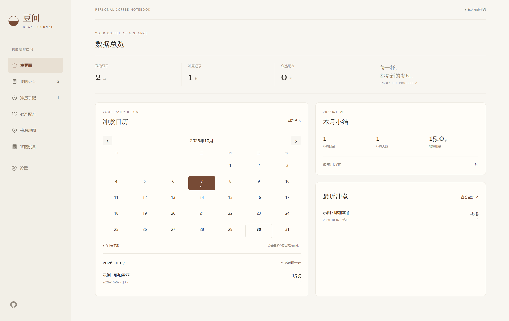
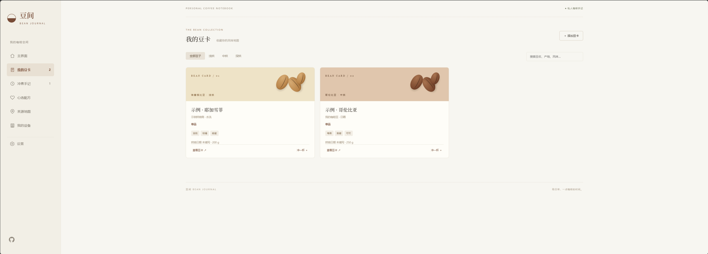
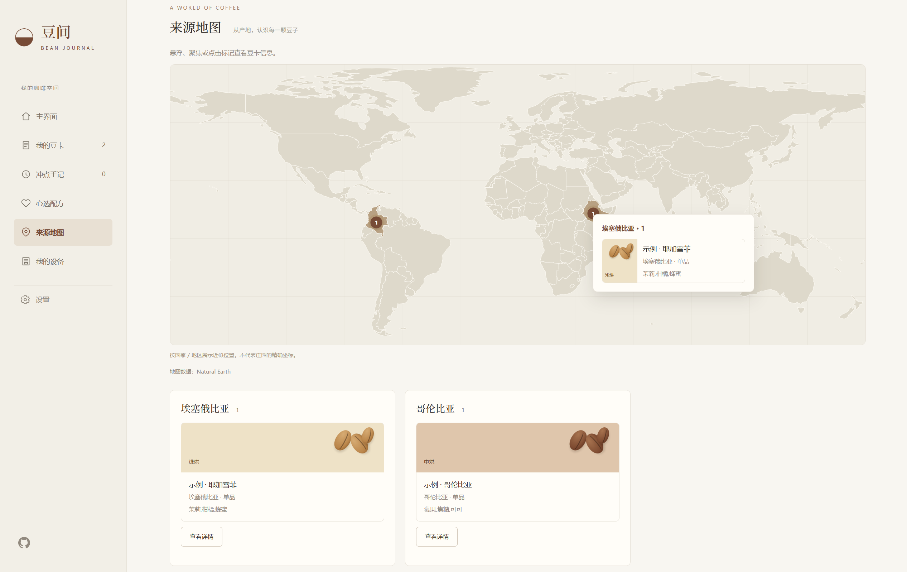

<p align="center">
  
</p>
<h1 align="center">Bean Journal · 豆间</h1>
<p align="center">
  <a href="README.md">[ 简体中文 ]</a> | <a href="README.en.md">[ English ]</a>
</p>

<p align="center">把喜欢的风味，留在每一页。收藏豆卡，记录每次冲煮，保存心选配方。</p>
<p align="center"><strong>v1.0 · 中文 / English · 深浅主题 · 浏览器本地存储</strong></p>

豆间是一个属于咖啡爱好者的个人手记网站，采用原生 HTML、CSS 和 JavaScript。用豆卡收藏风味，用冲煮记录留住每一杯，用配方保存可反复使用的方案，无需后端和构建步骤。

## 真实截图

以下为项目所有者提供的实际页面截图，展示中文界面与示例豆卡。点击图片可查看原始分辨率。

### 主界面与冲煮日历

查看做过咖啡的日期、本月咖啡用量和最近冲煮。

[](docs/images/dashboard.png)

### 我的豆卡

集中记录产地、烘焙度、处理法和风味，上传的照片仅在豆卡详情中展示。

[](docs/images/bean-cards.png)

### 来源地图

根据豆卡标记咖啡原产地，悬浮标记即可查看关联豆卡。

[](docs/images/origin-map.png)

## 功能

- **主界面：** 数据总览、冲煮日历、每日记录、本月小结、最近冲煮。
- **豆卡：** 产地、处理法、烘焙度、单品 / 拼配、风味与详情照片。
- **冲煮手记：** 为每一杯记录实际研磨度、粉重、液重 / 注水量、萃取时间、水温、评分和品饮笔记。
- **心选配方：** 长期保存目标参数、设备与步骤；冲煮时选择配方、查看步骤，独立调整本次实际值。
- **我的设备：** 添加、重命名或停用咖啡机和磨豆机；历史冲煮保留设备名称快照。
- **来源地图：** 按识别出的国家 / 地区汇总豆卡，并显示悬浮详情。
- **设置与备份：** 中英文、深浅主题；JSON 导入导出，包含照片。
- **历史记录保留：** 删除豆卡不会删除关联冲煮记录；旧版爱心收藏自动迁移为独立配方。

## 本地运行

安装 **Node.js 22 或更高版本**，在项目目录运行：

```sh
npm start
```

打开 **http://127.0.0.1:8080**。本地服务仅使用 Node.js 内置模块，单纯运行网站无需安装开发依赖。请通过 HTTP 服务打开，不要直接双击 HTML。

## 开发检查

```sh
npm ci
npm test
npm run format
```

测试使用 jsdom，覆盖设置、翻译、照片、旧数据兼容、地图、日历、设备、配方、备份校验、历史记录保留和多标签页冲突。测试不代替真实浏览器的视觉和文件上传检查。

## 目录

```text
dist/                  可直接部署的静态源码，无构建步骤
  index.html           页面结构
  style.css            基础样式
  enhancements.css     主题、地图和主界面样式
  app.js               豆卡表单、持久化与备份
  preferences.js       语言、主题与照片处理
  samples.js           示例豆卡本地化
  map-data.js          Natural Earth 地图数据
  origin-map.js        来源识别与地图交互
  dashboard.js         日历、统计和最近冲煮
  workbench.js         设备、配方、冲煮记录与迁移
  licenses/            第三方许可
docs/images/           项目图标与原始截图
scripts/serve.cjs      本地 HTTP 服务器
tests/                 功能回归测试
README.md              简体中文说明，默认展示
README.en.md           英文说明
README.zh-CN.md         简体中文兼容副本
```

## 数据与部署

所有记录和照片保存在**当前浏览器的 localStorage**，**没有云同步**。迁移浏览器或域名前，请先从设置导出备份，再在目标环境导入。浏览器清理和存储配额会影响数据保存，建议定期备份。

使用支持 **Web Locks** 的现代浏览器；正式部署使用 **HTTPS**，本地开发使用 localhost / 127.0.0.1。多标签页独立新增会合并保存；同一记录的冲突会阻止覆盖，并提示重新打开。

将 `dist/` 作为静态网站目录部署即可，无需 API 密钥或服务器环境变量。本仓库不包含 Sites 托管身份、发布凭据和个人备份文件。

地图使用近似国家 / 地区标记，不是庄园定位；无法识别的来源会列为待补充。照片在本地压缩，仅在详情中显示。字体从 Google Fonts 加载，网络不可用时回退到本地字体；地图不依赖在线地图 API。

## 支持项目

如果豆间对你有帮助，欢迎请我喝杯咖啡，支持项目的维护与更新。感谢你的支持！

**[☕ Buy Me a Coffee](https://buymeacoffee.com/tzbqweas)**

也可以使用微信或支付宝扫码支持，点击图片可查看原图。

<table>
  <tr><th align="center">微信支付</th><th align="center">支付宝</th></tr>
  <tr>
    <td align="center"><a href="docs/donate/wechat.jpg"></a></td>
    <td align="center"><a href="docs/donate/alipay.jpg"></a></td>
  </tr>
</table>

捐赠完全自愿，不影响任何功能的使用。

## 版本与致谢

当前版本：**v1.0**。更新说明见 [CHANGELOG.md](CHANGELOG.md)，第三方资源与许可见 [THIRD_PARTY_NOTICES.md](THIRD_PARTY_NOTICES.md)。
