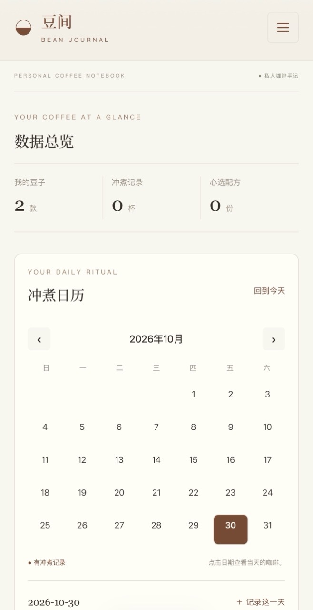
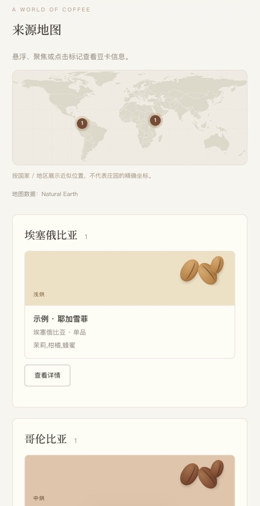

<p align="center">
  
</p>
<h1 align="center">Bean Journal · 豆间</h1>
<p align="center">
  <a href="README.md">[ 简体中文 ]</a> | <a href="README.en.md">[ English ]</a>
</p>

<p align="center">把喜欢的风味，留在每一页。收藏豆卡，记录每次冲煮，保存心选配方。</p>
<p align="center"><strong>v1.3 · SQLite 多端同步 · 中文 / English · 深浅主题</strong></p>

豆间是一个属于咖啡爱好者的个人手记网站，采用原生 HTML、CSS 和 JavaScript。用豆卡收藏风味，用冲煮记录留住每一杯，用配方保存可反复使用的方案，当前源码可通过一体化 Node.js / SQLite 服务自托管，也保留纯静态部署方式。

## v1.3 更新

新增 SQLite 自托管多端同步；设备品牌与型号分开，支持买入价格、自定义货币单位、买入日期和修改类型；日期格式统一，并补全多端冲突保护。详见 [中英文发布说明](docs/releases/v1.3.md) 和 [更新记录](CHANGELOG.md)。

**从 v1.2 升级：先在旧浏览器设置中导出 JSON 备份。** v1.3 启动后导入选定备份，导入会替换共享实例的全部记录；其他设备访问同一实例即可。旧浏览器数据会保留，不会自动合并或持续同步。

## 真实截图

以下为项目所有者提供的实际页面截图，展示中文界面与示例豆卡。点击图片可查看原始分辨率。

### 主界面与冲煮日历

查看做过咖啡的日期、本月咖啡用量和最近冲煮。

[](docs/images/dashboard.png)

### 我的豆卡

集中记录产地、烘焙度、处理法和风味，上传的照片仅在豆卡详情中展示。

[](docs/images/bean-cards.png)

### 来源地图

根据豆卡标记咖啡原产地，悬浮标记即可查看关联豆卡。

[](docs/images/origin-map.png)

### 手机实拍

以下为项目所有者提供的手机真实截图。两张图片统一为 658 × 1280 像素，以相同尺寸展示，点击可查看原图。

<table>
  <tr>
    <th>主界面与冲煮日历</th>
    <th>来源地图与豆卡</th>
  </tr>
  <tr>
    <td align="center"><a href="docs/images/mobile-dashboard.jpg"></a></td>
    <td align="center"><a href="docs/images/mobile-origin-map.jpg"></a></td>
  </tr>
</table>

## 功能

- **主界面：** 数据总览、冲煮日历、每日记录、本月小结、最近冲煮。
- **豆卡：** 产地、处理法、烘焙度、单品 / 拼配、风味与详情照片。
- **冲煮手记：** 为每一杯记录实际研磨度、粉重、液重 / 注水量、萃取时间、水温、评分和品饮笔记。
- **心选配方：** 长期保存目标参数、设备与步骤；冲煮时选择配方、查看步骤，独立调整本次实际值。
- **我的设备：** 添加、重命名或停用咖啡机和磨豆机；历史冲煮保留设备名称快照。
- **来源地图：** 按识别出的国家 / 地区汇总豆卡，并显示悬浮详情。
- **设置与备份：** 中英文、深浅主题；JSON 导入导出，包含照片。
- **历史记录保留：** 删除豆卡不会删除关联冲煮记录；旧版爱心收藏自动迁移为独立配方。

## Docker 部署

公开镜像：[tzbqweas/bean-journal](https://hub.docker.com/r/tzbqweas/bean-journal)。发布时 `1.3` 和 `latest` 均指向 v1.3；固定版本请使用 `1.3`。本次发布架构：`linux/amd64`。

```sh
docker pull tzbqweas/bean-journal:1.3
docker run -d --name bean-journal -p 8080:8080 -v bean-journal-data:/data --restart unless-stopped tzbqweas/bean-journal:1.3
```

电脑打开 `http://localhost:8080`，手机或 iPad 打开 `http://服务器局域网IP:8080`。所有设备必须访问同一实例，主机需允许对应端口。**没有登录：能够访问实例的人都可以查看和修改全部记录。**

### Docker Compose

直接使用仓库的 `compose.yaml`，或创建以下文件：

```yaml
services:
  bean-journal:
    image: tzbqweas/bean-journal:1.3
    ports:
      - "8080:8080"
    volumes:
      - bean-journal-data:/data
    restart: unless-stopped
    read_only: true
    tmpfs:
      - /tmp:rw,noexec,nosuid,size=16m,mode=1777
    cap_drop:
      - ALL
    security_opt:
      - no-new-privileges:true
volumes:
  bean-journal-data:

```

```sh
docker compose pull
docker compose up -d
```

升级时沿用相同 Compose 项目名和数据卷。数据及照片保存在 `/data/journal.sqlite`；**不要执行 `docker compose down -v`，它会删除数据卷。** 日常备份使用设置中的 JSON 导出，包含照片。文件级备份先停止服务，再复制完整数据目录。

### 从源码构建或归档镜像

```sh
docker build -t bean-journal:1.3 .
docker save -o bean-journal-1.3.tar tzbqweas/bean-journal:1.3
docker load -i bean-journal-1.3.tar
```

镜像包含网页、Node.js 与 SQLite，不包含开发依赖或个人数据。导入镜像后用上面的启动命令运行并挂载数据卷。其他受支持架构可在对应主机源码构建；本次发布镜像为 amd64。

## 本地运行

安装 Node.js 24.14 或更高的 24.x 版本，在项目目录运行：

```sh
npm start
```

打开 `http://localhost:8080`。运行只使用 Node.js 内置模块，不必安装开发依赖。数据库默认在 `data/`；可通过 `DATA_DIR`、`PORT`、`HOST` 调整目录、端口和监听地址。`npm run start:static` 保留纯静态浏览器存储模式，此模式不提供多端同步。

## 数据与同步

页面约每 5 秒及重新获得焦点时检查更新；编辑中暂停自动刷新，保存时校验冲突。历史设备关联保留，语言与主题各设备独立设置。不提供多人账户或离线队列。详见 [自托管同步与备份说明](docs/self-hosted-sync.md)。

## 开发检查

```sh
npm ci
npm test
```

覆盖原有功能、旧数据、设备管理、备份校验、HTTP/SQLite 持久化、并发保存、过期编辑、配置失败和服务恢复。自动化测试不代替所有真机验证。

```text
dist/          前端与共享数据校验
server/        HTTP API 与 SQLite 存储
scripts/       可选静态服务器
tests/         回归测试
docs/          截图、部署和发布说明
compose.yaml   Docker Hub 镜像持久化部署
```

## 支持项目

如果豆间对你有帮助，欢迎请我喝杯咖啡，支持项目的维护与更新。感谢你的支持！

**[☕ Buy Me a Coffee](https://buymeacoffee.com/tzbqweas)**

也可以使用微信或支付宝扫码支持，点击图片可查看原图。

<table>
  <tr><th align="center">微信支付</th><th align="center">支付宝</th></tr>
  <tr>
    <td align="center"><a href="docs/donate/wechat.jpg"></a></td>
    <td align="center"><a href="docs/donate/alipay.jpg"></a></td>
  </tr>
</table>

捐赠完全自愿，不影响任何功能的使用。

## 版本与致谢

当前版本：**v1.3** 更新说明见 [CHANGELOG.md](CHANGELOG.md)，第三方资源与许可见 [THIRD_PARTY_NOTICES.md](THIRD_PARTY_NOTICES.md)。
